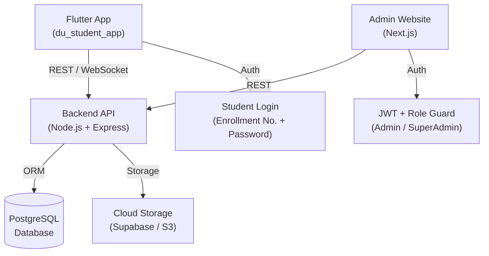
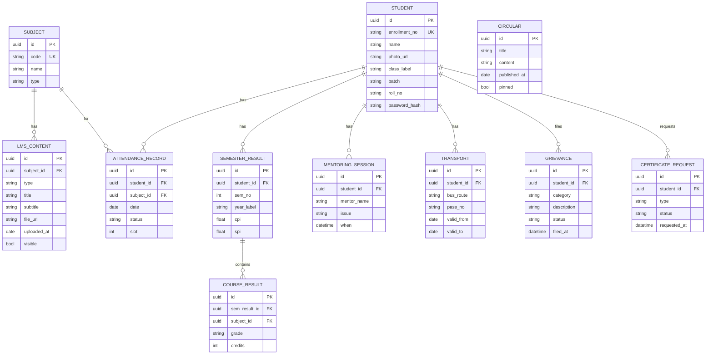
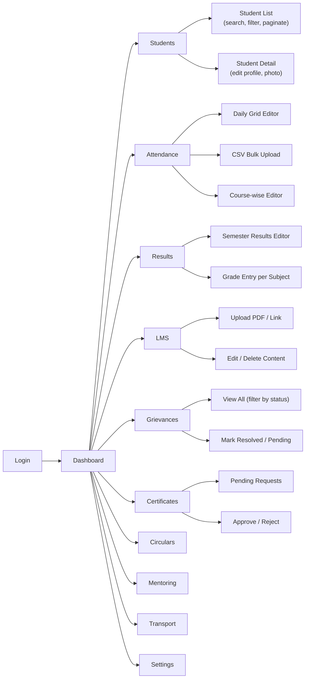
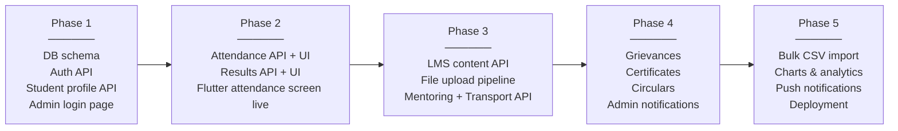

# DU Student App — Backend + Admin Website Plan

> [!IMPORTANT]
> This is a **living plan document**. Every section below maps directly to a feature in the existing Flutter app that is currently hard-coded in `demo_data.dart` or screen files.

---

## 1. The Big Picture



---

## 2. Tech Stack

### Backend (API Server)
| Layer | Choice | Why |
|---|---|---|
| Runtime | **Node.js** (TypeScript) | Fast to build, great ecosystem, type-safe |
| Framework | **Express.js** | Minimal, easy to extend |
| ORM | **Prisma** | Auto-generates types from schema, great migrations |
| Database | **PostgreSQL** | Relational, perfect for student data |
| Auth | **JWT + bcrypt** | Stateless, works for both app & admin site |
| File Storage | **Supabase Storage** (or AWS S3) | For PDFs, lab manuals, photos |
| Realtime (optional) | **Socket.IO** | Push notifications to the Flutter app |
| Validation | **Zod** | Runtime schema validation on all API inputs |

### Admin Website
| Layer | Choice | Why |
|---|---|---|
| Framework | **Next.js 14** (App Router) | SSR, file-based routing, great DX |
| UI Library | **shadcn/ui + Tailwind CSS** | Polished admin components out of the box |
| State / Data | **TanStack Query (React Query)** | Caching, loading states, refetch on focus |
| Forms | **React Hook Form + Zod** | Validation mirrored from backend |
| Auth | **next-auth / custom JWT** | Session management |
| Tables | **TanStack Table** | Sortable, filterable data grids |
| Charts | **Recharts** | Attendance % charts, CPI graphs |

### Flutter App Changes
| Concern | Change |
|---|---|
| HTTP client | Add **`dio`** package |
| Auth state | **`flutter_secure_storage`** for JWT token |
| State management | **`riverpod`** (or `provider`) for server state |
| Replace `demo_data.dart` | Fetch everything from API; show loading skeletons |

### Hosting (Recommended)
| Service | Usage |
|---|---|
| **Railway** or **Render** | Host the Node.js API (free tier to start) |
| **Vercel** | Host the Next.js admin website (free) |
| **Supabase** | Managed PostgreSQL + file storage (free tier) |

---

## 3. Database Schema (Core Tables)



---

## 4. API Endpoints

### Auth
| Method | Route | Description |
|---|---|---|
| `POST` | `/api/auth/login` | Student login → returns JWT |
| `POST` | `/api/auth/admin/login` | Admin login → returns admin JWT |
| `POST` | `/api/auth/refresh` | Refresh access token |

### Student (Flutter App consumes these)
| Method | Route | Description |
|---|---|---|
| `GET` | `/api/student/profile` | Name, photo, class, roll no |
| `GET` | `/api/student/attendance` | Attendance grid rows |
| `GET` | `/api/student/attendance/past-sems` | Past semester % |
| `GET` | `/api/student/attendance/courses` | Per-course attendance |
| `GET` | `/api/student/results` | CPI, SPI, backlogs, grades |
| `GET` | `/api/student/lms/:subjectId/presentations` | Presentations list |
| `GET` | `/api/student/lms/:subjectId/lab-manuals` | Lab manuals list |
| `GET` | `/api/student/mentoring` | Mentor info + session list |
| `GET` | `/api/student/transport` | Bus pass + route info |
| `GET` | `/api/student/circulars` | Circulars list |
| `GET` | `/api/student/grievances` | Student's own grievances |
| `POST` | `/api/student/grievances` | File a new grievance |
| `GET` | `/api/student/certificates` | Certificate requests |
| `POST` | `/api/student/certificates` | Submit a new request |
| `GET` | `/api/student/exam-schedule` | Exam dates |

### Admin (Admin website consumes these)
| Method | Route | Description |
|---|---|---|
| `GET/POST/PUT/DELETE` | `/api/admin/students` | Full CRUD on students |
| `GET/POST/PUT/DELETE` | `/api/admin/subjects` | Manage subjects |
| `POST` | `/api/admin/attendance/bulk` | Upload/edit attendance in bulk |
| `GET/POST/PUT` | `/api/admin/results` | Manage results & grades |
| `GET/POST/PUT/DELETE` | `/api/admin/lms` | Add/edit/delete LMS content |
| `GET/PUT` | `/api/admin/grievances` | View & update grievance status |
| `GET/PUT` | `/api/admin/certificates` | View & approve certificate requests |
| `GET/POST/PUT/DELETE` | `/api/admin/circulars` | Publish/edit circulars |
| `GET/POST/PUT/DELETE` | `/api/admin/mentoring` | Manage mentoring sessions |
| `GET/POST/PUT/DELETE` | `/api/admin/transport` | Edit bus passes & routes |

---

## 5. Admin Website — Pages & Features



### Key Admin UI patterns
- **Data Tables**: sortable, searchable, paginated (TanStack Table)
- **Inline Edit**: click a cell → edit in place → auto-save
- **Bulk CSV Import**: for attendance and results (upload `.csv`, preview, confirm)
- **Rich Text / Markdown**: for circulars and announcements
- **File Upload**: drag-and-drop PDFs for LMS content (direct to Supabase Storage)
- **Status Badges**: colour-coded chips for Grievance / Certificate status
- **Charts**: attendance % bar chart per student, CPI trend line chart

---

## 6. Flutter App Migration Plan

Replace every hard-coded constant with a **repository + provider** pattern:

```
demo_data.dart  →  lib/repositories/student_repo.dart   (API calls)
                   lib/providers/student_provider.dart  (Riverpod)
```

Each screen will:
1. Show a **skeleton loader** while fetching
2. Display **live data** from the API
3. Show an **error card** with retry on network failure

The JWT token is stored in `flutter_secure_storage` and refreshed silently.

---

## 7. Build Phases



| Phase | Deliverable | Approx. time |
|---|---|---|
| 1 | Auth + profile + admin skeleton | 1–2 weeks |
| 2 | Attendance + results (most-used screens) | 1–2 weeks |
| 3 | LMS, mentoring, transport | 1–2 weeks |
| 4 | Grievances, certificates, circulars | 1 week |
| 5 | Polish, bulk import, deploy | 1 week |

---

## 8. Folder Structure

### Backend (`du_student_api/`)
```
src/
├── routes/
│   ├── auth.ts
│   ├── student.ts
│   └── admin/
│       ├── students.ts
│       ├── attendance.ts
│       ├── results.ts
│       └── ...
├── controllers/
├── services/
├── middlewares/
│   ├── auth.ts         ← JWT verify
│   └── adminGuard.ts   ← role check
├── prisma/
│   └── schema.prisma
└── index.ts
```

### Admin Website (`du_admin_web/`)
```
app/
├── (auth)/
│   └── login/
├── (dashboard)/
│   ├── layout.tsx      ← sidebar + topbar
│   ├── page.tsx        ← overview
│   ├── students/
│   ├── attendance/
│   ├── results/
│   ├── lms/
│   ├── grievances/
│   ├── circulars/
│   └── transport/
components/
├── ui/                 ← shadcn components
├── data-table/
└── charts/
lib/
├── api.ts              ← axios instance with auth header
└── types.ts
```

---

## 9. Security Checklist

- [ ] All admin routes protected by role-based JWT middleware
- [ ] Students can only read **their own** data (enforced server-side by student ID from token)
- [ ] Passwords hashed with **bcrypt** (cost factor 12)
- [ ] File uploads validated by MIME type and size limit
- [ ] Input sanitised via **Zod** on every endpoint
- [ ] HTTPS enforced in production
- [ ] Rate limiting on login endpoints (prevent brute force)
- [ ] CORS restricted to known origins (Flutter app + admin domain)

---

> [!TIP]
> **Start with Phase 1** — get the database schema right first, because every other feature depends on it. The admin website is the **single source of truth** that feeds the Flutter app.
